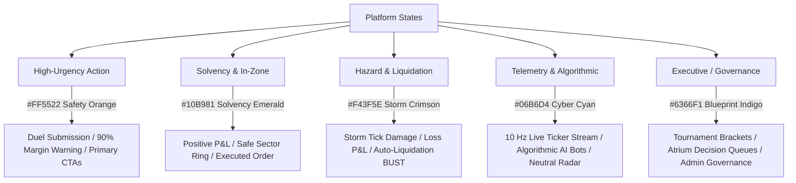

# 01. Foundations & Chromatic Semantics

> **Axiom:** _Colors are system states. Surfaces are physical planes. No pixel exists without functional justification._

---

## 1. The Core Philosophy

In consumer software, color and contrast are often treated as aesthetic decoration. In **Fintasy**, every chromatic value and surface boundary corresponds directly to an operational reality:

1. **Retinal Comfort Under Sustained Focus:** Traders and gamers stare at data streams for hours. High-contrast pure black (`#000000`) paired with harsh white (`#FFFFFF`) causes OLED smearing, pupil fatigue, and chromatic aberration. Our baseline canvas is a deep oceanic midnight (`#07090E`) that absorbs excess glare while providing infinite contrast for telemetry.
2. **Zero Ambiguity in Hazard Signaling:** In a 30-second trading duel with 5x leverage or a collapsing storm circle, a user has sub-second cognitive windows. Red, orange, green, and cyan must have immutable, unambiguous meanings across every screen.
3. **Physical Drafting Geometry:** Instead of fuzzy, arbitrary Gaussian drop-shadows, components derive depth and structure through **hairline drafting lines** (`rgba(255, 255, 255, 0.08)`) and **calibrated surface elevation steps**.
4. **The Ten Principles of Dieter Rams:** Every component is subjected to the litmus test of _Weniger, aber besser_ (Less, but better)—prioritizing utility, honesty, unobtrusiveness, digital efficiency, and thoroughness down to the integer cent (see [00. The 10 Principles of Dieter Rams](./00-DIETER-RAMS-PRINCIPLES.md)).

---

## 2. Surface Architecture & Elevation Tokens

Fintasy organizes visual space into four distinct elevation planes. Each plane is mathematically stepped in luminance to create natural depth without visual clutter:

```
+-------------------------------------------------------------------------+
| Level 3: Interactive Floats & Modals (#1D263B)                           |
|   +-------------------------------------------------------------------+ |
|   | Level 2: Cards, Inputs & Interactive Hover States (#151C2B)       | |
|   |   +-------------------------------------------------------------+ | |
|   |   | Level 1: Panels, Sidebars & Containment Grids (#0E121B)     | | |
|   |   |   +-------------------------------------------------------+ | | |
|   |   |   | Level 0: Primary Chassis Canvas (#07090E)             | | | |
|   |   |   +-------------------------------------------------------+ | | |
|   |   +-------------------------------------------------------------+ | |
|   +-------------------------------------------------------------------+ |
+-------------------------------------------------------------------------+
```

### Elevation Token Specifications

| Token                 | Hex / Value                 | Usage & Rationale                                                                                                     |
| :-------------------- | :-------------------------- | :-------------------------------------------------------------------------------------------------------------------- |
| `--fn-surface-canvas` | `#07090E`                   | **Level 0 (Chassis):** The absolute root canvas. Provides deep contrast while preventing eye strain.                  |
| `--fn-surface-panel`  | `#0E121B`                   | **Level 1 (Structural Containers):** Sidebars, main layout grids, radar perimeter panels, header rails.               |
| `--fn-surface-card`   | `#151C2B`                   | **Level 2 (Component Bodies):** Data table cards, duel arena terminal panes, active position cards, tournament tiles. |
| `--fn-surface-float`  | `#1D263B`                   | **Level 3 (Interactive Elements):** Modal dialogs, dropdown menus, tooltip popovers, active input field fills.        |
| `--fn-surface-hover`  | `#232E47`                   | **Hover State:** Micro-elevation on hover/focus to indicate interactive affordance.                                   |
| `--fn-border-subtle`  | `rgba(255, 255, 255, 0.06)` | **Hairline Boundary:** Subtle inner partitions and table row dividers.                                                |
| `--fn-border-default` | `rgba(255, 255, 255, 0.12)` | **Structural Boundary:** Primary card outlines, panel borders, container frames.                                      |
| `--fn-border-focus`   | `rgba(255, 255, 255, 0.28)` | **Focused Boundary:** Keyboard focus, active tab outlines, selected cards.                                            |

---

## 3. Chromatic Semantics: The Telemetry Spectrum

Colors in Fintasy are mapped to **real-time platform states**. Never apply an accent color because it looks pleasant; apply it only when the underlying state demands it.



### Detailed Token Map

#### 1. International Safety Orange (`--fn-accent-orange`)

- **Tokens:**
  - Base: `#FF5522`
  - Bright / Glow: `#FF6B35`
  - Muted / Container: `rgba(255, 85, 34, 0.15)`
- **Meaning:** **The Action Horizon.** Demands immediate, conscious user intervention.
- **Approved Uses:**
  - Active duel countdowns when under 15 seconds.
  - Margin depletion indicator when entering danger threshold (70%–89%).
  - The primary execution trigger ("BUY LONG" / "SELL SHORT" / "SUBMIT DUEL").
  - Team collaboration tags and highlighted waypoint nodes on blueprint canvases.
- **Prohibited Uses:** Do NOT use for passive dashboard charts, regular links, or general informative text.

#### 2. Solvency Emerald (`--fn-accent-emerald`)

- **Tokens:**
  - Base: `#10B981`
  - Glow: `#34D399`
  - Muted / Container: `rgba(16, 185, 129, 0.12)`
- **Meaning:** **Capital Growth & Environmental Safety.**
- **Approved Uses:**
  - Positive P&L gains (`+$497.50 (+3.32%)`).
  - Sectors currently inside the safe zone (non-storm).
  - Successful order fills and transaction confirmations.
  - Within-policy badges in decision queues.

#### 3. Hazard & Storm Crimson (`--fn-accent-crimson`)

- **Tokens:**
  - Base: `#F43F5E`
  - Glow: `#FB7185`
  - Muted / Container: `rgba(244, 63, 94, 0.15)`
- **Meaning:** **Capital Depletion, Storm Encroachment & Liquidation.**
- **Approved Uses:**
  - Negative P&L drawdowns (`-$320.00 (-2.14%)`).
  - Storm collapse tick damage notifications (`-$50/s in Outer Ring`).
  - Auto-liquidation margin breaches (90% depletion BUST state).
  - Critical API disconnection or live-feed failure states.

#### 4. Cyber Telemetry Cyan (`--fn-accent-cyan`)

- **Tokens:**
  - Base: `#06B6D4`
  - Glow: `#38BDF8`
  - Muted / Container: `rgba(6, 182, 212, 0.12)`
- **Meaning:** **Neutral Data Streams & Algorithmic Telemetry.**
- **Approved Uses:**
  - 10 Hz Geometric Brownian Motion tick streams.
  - AI bot archetype badges (Momentum, Mean Reversion, Breakout, Scalper).
  - Active leverage chips (`1x`, `2x`, `5x`).
  - Neutral radar grid concentric rings.

#### 5. Blueprint Indigo (`--fn-accent-indigo`)

- **Tokens:**
  - Base: `#6366F1`
  - Glow: `#818CF8`
  - Muted / Container: `rgba(99, 102, 241, 0.12)`
- **Meaning:** **Governance, Brackets & Portfolio Analytics.**
- **Approved Uses:**
  - Tournament brackets and MMR ladder standings.
  - Atrium-style executive briefing cards.
  - Neutral portfolio asset distribution donut rings.

---

## 4. Unified Surface Architecture: Deep Midnight HUD

By unanimous design decision, Fintasy adheres to a **Unified Deep Midnight HUD (`#07090E`)** across all product surfaces (Stock Royale, Trading Terminal, Paper Trading Portfolio, Tournaments, and Settings).

Rather than switching to a jarring light mode, the physical Swiss blueprint aesthetic (dot-matrix grids, crosshair coordinates, and technical line brackets) is rendered directly onto the dark canvas:

- **Chassis Canvas:** Solid `#07090E` with an optional subtle 24px atmospheric dot grid (`rgba(255, 255, 255, 0.05)`).
- **Elevation Hierarchy:** Level 1 `#0E121B` (panels & sidebars) -> Level 2 `#151C2B` (cards & terminals) -> Level 3 `#1D263B` (modals & popovers).
- **Drafting Borders:** Crisp hairline rules (`rgba(255, 255, 255, 0.08)`) with `+` reticles at key grid intersections.
- **Result:** Total visual continuity when transitioning between an analytical portfolio review and an intense 30-second Stock Royale duel.

---

## 5. Contrast & Accessibility Commitments

- All normal text (UI labels, body copy, descriptions) must maintain a minimum contrast ratio of **4.5:1** against its immediate container surface (WCAG AA).
- All large numbers and primary telemetry values must maintain a minimum contrast ratio of **7:1** (WCAG AAA).
- State information must **never be conveyed through color alone**:
  - Positive P&L must feature a leading explicit plus sign (`+$...`).
  - Negative P&L must feature a leading explicit minus sign (`-$...`).
  - Storm and margin hazards must be paired with distinct glyphs (`⚠️`, `⚡`) and textual status chips (`CRITICAL DEPLETION`).
