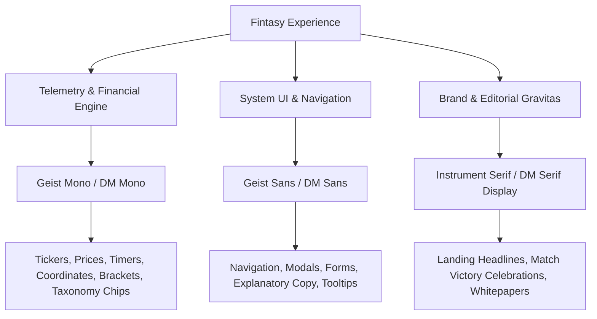

# 02. Typography & The Tabular Law

> **The Law:** _Digits in motion must never drift. Text in an operational interface is technical instrumentation, not arbitrary prose._

---

## 1. The Tabular Law of Financial Invariants

In standard web design, proportional typefaces (where the digit `1` occupies less horizontal width than the digit `8`) are standard. In high-frequency financial platforms and combat duels, **proportional figures are catastrophic**:

- **Lateral Visual Jitter:** When a stock ticks from `$128.11` to `$128.88` at 10 Hz, a proportional font causes the decimal point, surrounding text, and adjacent columns to shift laterally 10 times per second. This triggers micro-saccadic eye strain and degrades decision-making speed.
- **Columnar Misalignment:** In an orderbook or portfolio ledger, decimal points and integer cents must form a strict, unbroken vertical line down the screen.

```
PROPORTIONAL (INCORRECT - DRIFTING COLUMNS):
  NVDA:   $128.11
  TSLA:   $242.88  <- Column edges and decimal points wobble laterally
  BTC:    $64,120.00

TABULAR MONOSPACE (CORRECT - RIGID MATRIX):
  NVDA:   $   128.11
  TSLA:   $   242.88  <- Strict vertical baseline and decimal lock
  BTC:    $64,120.00
```

### The Invariant Rules:

1. **All currency values, P&L percentages, timers, coordinates, order sizes, and tick feeds MUST use a monospace font or enforce `font-variant-numeric: tabular-nums lining-nums`.**
2. Decimal points must always align vertically across lists and tabular ledgers.
3. Monetary numbers must format cents with two fixed decimal places (`$150.00`, never `$150`).

---

## 2. The Tri-Font Architecture

Fintasy employs three distinct typographic voices, each strictly bound to a functional layer:



### Typographic Specifications

| Role                    | Primary Font       | Fallback Stack                                  | Functional Purpose                                                              |
| :---------------------- | :----------------- | :---------------------------------------------- | :------------------------------------------------------------------------------ |
| **Telemetry & Numbers** | `Geist Mono`       | `DM Mono`, `JetBrains Mono`, `monospace`        | Tabular data, P&L, real-time clock, order entry, bracket badges (`[ 01 RUN ]`). |
| **System Interface**    | `Geist Sans`       | `DM Sans`, `-apple-system`, `sans-serif`        | Clean, neutral, high-legibility interface copy, settings, table headers, forms. |
| **Editorial & Brand**   | `Instrument Serif` | `DM Serif Display`, `Playfair Display`, `serif` | High-contrast editorial authority, hero banners, champion title cards.          |

---

## 3. Typographic Hierarchy & Scale

Our type scale uses a deliberate geometric progression optimized for high-density information architecture:

| Token / Class    | Size               | Line Height | Tracking  | Weight           | Target Application                                                              |
| :--------------- | :----------------- | :---------- | :-------- | :--------------- | :------------------------------------------------------------------------------ |
| `text-display`   | `3.50rem` (56px)   | `1.05`      | `-0.03em` | Regular / Italic | Editorial hero titles (Serif).                                                  |
| `text-h1`        | `2.25rem` (36px)   | `1.15`      | `-0.02em` | Bold (`700`)     | Major page headers, champion victory titles.                                    |
| `text-h2`        | `1.50rem` (24px)   | `1.25`      | `-0.01em` | Bold (`700`)     | Modal titles, arena zone headers, card titles.                                  |
| `text-h3`        | `1.125rem` (18px)  | `1.35`      | `0`       | Semibold (`600`) | Section subheads, table group headers.                                          |
| `text-body`      | `0.875rem` (14px)  | `1.50`      | `0`       | Regular (`400`)  | Standard body paragraphs, dialog descriptions.                                  |
| `text-caption`   | `0.75rem` (12px)   | `1.40`      | `+0.01em` | Medium (`500`)   | Secondary labels, timestamps, table column headers.                             |
| `text-mono-xl`   | `1.75rem` (28px)   | `1.10`      | `+0.02em` | Black (`900`)    | Live stock price display, countdown timer clock.                                |
| `text-mono-lg`   | `1.25rem` (20px)   | `1.20`      | `+0.01em` | Bold (`700`)     | Active balance displays, duel P&L totals.                                       |
| `text-mono-base` | `0.875rem` (14px)  | `1.40`      | `0`       | Regular / Bold   | Data table cells, orderbook bids/asks, order quantity.                          |
| `text-mono-chip` | `0.6875rem` (11px) | `1.20`      | `+0.08em` | Bold (`700`)     | Numbered badges (`02 SECONDARY FONT`), bracket chips (`[ NVDA ]`), status tags. |

---

## 4. Taxonomy & The Numbered Index Pattern

Inspired by technical blueprints and the _Geist Mono_ typographic specimen, all metadata chips and taxonomy tags adhere to a structured labeling grammar:

```
+------------------------------------+
| 02  SECONDARY FONT                 |  <- Numbered taxonomy badge with safety orange accent
+------------------------------------+

+------------------------------------+
| [ 01 PERFORMANCE ]                 |  <- Bracketed technical index chip
+------------------------------------+

+------------------------------------+
| [ 10 Hz GBM • TICK STREAM ]        |  <- Telemetry status indicator
+------------------------------------+
```

### Grammar Rules:

1. **Uppercase Only:** All index tags, taxonomy badges, sector acronyms (`SEMIS_AI`, `BIG_TECH`), and order sides (`LONG`, `SHORT`) must be strictly uppercase.
2. **Bracketed Enclosure:** Use square brackets `[ ... ]` around real-time system modes to signal automated telemetry (e.g. `[ 1x LEVERAGE ]`, `[ LIVE TICKS ]`).
3. **Numbered Prefixes:** High-level system categories should use two-digit zero-padded prefixes (`01 OVERVIEW`, `02 ROYALE`, `03 PORTFOLIO`, `04 SETTINGS`).
